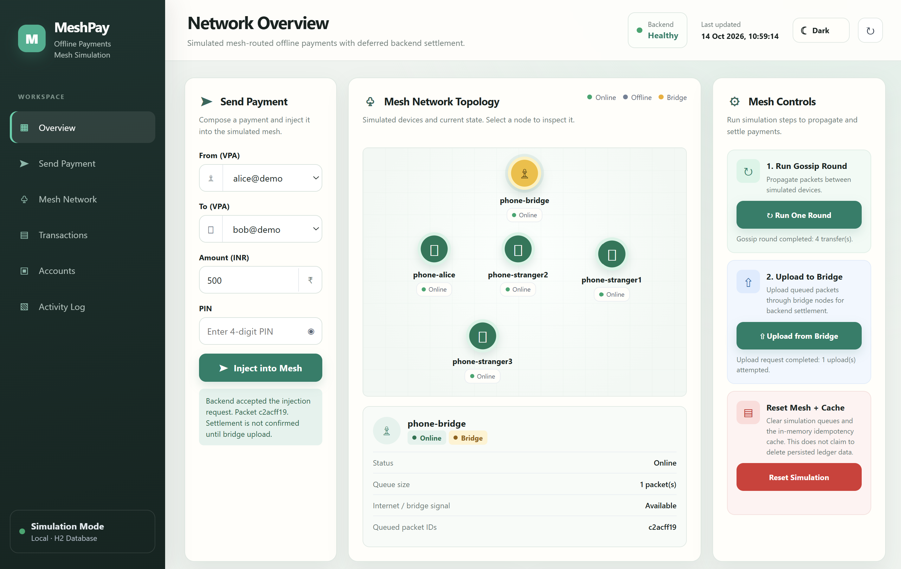

# MeshPay

MeshPay is a simulated offline payment-mesh demo. It shows **mesh-routed deferred settlement of UPI-style payments**: this process encrypts a payment, copies the ciphertext between virtual phones, and settles it only after a bridge device uploads it to the backend.

The sender phone and the mesh are software. There is no Bluetooth radio, no NPCI connection, and no production payment rail. The server in this repository is a Spring Boot app with an in-memory H2 database.

The dashboard form defaults to ₹500 from `alice@demo` to `bob@demo`. That amount is an input, not a separate payment network.

---

## Ownership

| | |
|---|---|
| Author | Suman, the author recorded on this repository's only commit (`sumandey7684@gmail.com`) |
| Repository | https://github.com/sumandey7684/MeshPay |
| Project role | Spring Boot backend and in-process mesh simulator for the demo above |
| Recorded date | 15 October 2026, the author date of the commit whose message is `first commit`. Git has no earlier history, so dates before that commit are not recorded |
| Stack | Java 17, Spring Boot 3.3.5 |
| Run | Windows: `mvnw.cmd spring-boot:run` (PowerShell: `.\mvnw.cmd spring-boot:run`). macOS/Linux: `./mvnw spring-boot:run` |

Java packages stay `com.demo.upimesh`. The Maven artifact id in `pom.xml` stays `upi-offline-mesh`.

The only commit adds this demo in its current form: backend, simulator, dashboard, and tests. The repository does not record a split of work across people, or a development timeline before that commit.

---

## Table of Contents

1. [What this demo proves](#what-this-demo-proves)
2. [How to run it](#how-to-run-it)
3. [The demo flow (step by step)](#the-demo-flow-step-by-step)
4. [Architecture](#architecture)
5. [The three hard problems and how they're solved](#the-three-hard-problems-and-how-theyre-solved)
6. [File-by-file walkthrough](#file-by-file-walkthrough)
7. [API reference](#api-reference)
8. [Tests](#tests)
9. [What's NOT real (and what would change for production)](#whats-not-real-and-what-would-change-for-production)
10. [Honest limitations of the concept](#honest-limitations-of-the-concept)

---

## What this demo proves

Three properties are implemented in this repository:

1. **The payment instruction is encrypted before it is copied through the simulator.** RSA-OAEP wraps a one-time AES-256 key. AES-256-GCM encrypts the JSON. Virtual devices can read `packetId`, `ttl`, and `createdAt`. They do not receive the server private key.
2. **The same ciphertext settles once inside this JVM.** `IdempotencyService` claims a SHA-256 of the ciphertext with `ConcurrentHashMap.putIfAbsent`. This is not a distributed lock and it is not Redis.
3. **A tampered ciphertext is rejected before settlement.** Flipping the ciphertext makes `HybridCryptoService.decrypt` throw. `BridgeIngestionService` then returns outcome `INVALID`.

**What the dashboard shows.** The default seed has five devices. Only `phone-bridge` is constructed with `hasInternet=true`. The dashboard shows encryption, one all-to-all gossip round, and a single in-process upload from that bridge.

**What the test shows.** Concurrent duplicate protection is `IdempotencyConcurrencyTest#singlePacketDeliveredByThreeBridgesSettlesExactlyOnce`. Three threads call `ingest` on one ₹100.00 packet. The test asserts one `SETTLED` outcome, two `DUPLICATE_DROPPED` outcomes, and a single ₹100.00 debit and credit between `alice@demo` and `bob@demo`. The default dashboard does not run that case.

---

## How to run it

### Prerequisites

- **JDK 17 or newer** on `PATH`, or `JAVA_HOME` set. Check with `java -version`.
- No separate database, Redis, or Maven install. The Maven wrapper downloads what it needs on the first run.

### Run on Windows

```cmd
mvnw.cmd spring-boot:run
```

On PowerShell, use `.\mvnw.cmd spring-boot:run`.

### Run on Mac/Linux

```bash
./mvnw spring-boot:run
```

### Open the dashboard

When the log shows `Started UpiMeshApplication`, open **http://localhost:8080**. The port is `server.port` in `application.properties`. The page follows the browser color scheme and has a light/dark toggle.



The screenshot is that page. The form shows `alice@demo` to `bob@demo` for ₹500. The topology shows the five seeded devices. Only `phone-bridge` is the bridge; the "Online" label is the dashboard's default device status, not an internet connection.

Startup seeds four accounts when the table is empty:

| VPA | Holder | Balance |
|---|---|---|
| `alice@demo` | Alice | ₹5000.00 |
| `bob@demo` | Bob | ₹1000.00 |
| `carol@demo` | Carol | ₹2500.00 |
| `dave@demo` | Dave | ₹500.00 |

`spring.jpa.hibernate.ddl-auto=create-drop`, so those rows disappear when the process stops. The sender dropdown lists Alice, Bob, and Carol. Dave is only in the receiver dropdown. The amount field defaults to 500.

### Stop the server

`Ctrl+C` in the terminal.

### Run the tests

```cmd
mvnw.cmd test
```

On PowerShell, use `.\mvnw.cmd test`. The class is `IdempotencyConcurrencyTest`.

---

## The demo flow (step by step)

### Step 1 — Compose a payment and encrypt it

Choose sender, receiver, amount, and a 4-digit PIN, then click **Inject into Mesh**. The server stores a SHA-256 of the PIN and does not verify it. It encrypts the payment with the server public key and holds the ciphertext on `phone-alice`.

### Step 2 — Run simulated mesh gossip

Click **Run One Round**. This process copies the packet to the other virtual devices. The mesh is simulated: there is no Bluetooth radio, and devices do not have to come into range.

### Step 3 — Upload from the bridge and settle the transaction

Click **Upload from Bridge**. `phone-bridge` is already online. Flush calls `BridgeIngestionService.ingest` in this process. It does not make an HTTP request to `/api/bridge/ingest`. Settlement is deferred until that call. If the sender's balance covers the amount, the balances move; if it does not, they stay unchanged.

### Step 4 — Verify concurrent idempotency through the automated test

The default dashboard has one bridge, so the upload above delivers a packet once. Concurrent delivery is proved by `IdempotencyConcurrencyTest#singlePacketDeliveredByThreeBridgesSettlesExactlyOnce`: three simultaneous deliveries of one ₹100.00 packet produce one `SETTLED` outcome and two `DUPLICATE_DROPPED` outcomes.

```cmd
mvnw.cmd test -Dtest=IdempotencyConcurrencyTest#singlePacketDeliveredByThreeBridgesSettlesExactlyOnce
```

---

## Architecture

The running demo is one JVM. `DemoService` plays the sender phone. `MeshSimulatorService` plays the mesh. `BridgeIngestionService` is the backend pipeline. H2 stores accounts and the ledger. Settlement waits until `ingest` runs, so it is deferred, not a real-time payment.


The picture is a concept drawing. These details follow the code instead:

- The default seed is five devices: `phone-alice`, `phone-stranger1`, `phone-stranger2`, `phone-stranger3`, and `phone-bridge`. The drawing shows a sender, four relay nodes, and a bridge.
- The upload arrow is labeled HTTPS. This demo listens on HTTP port 8080. Dashboard flush does not use HTTP for ingest; it calls `BridgeIngestionService` directly. `POST /api/bridge/ingest` is the HTTP entry to the same method.
- The claim step is labeled with Redis `SETNX` as an example. The implementation is `ConcurrentHashMap.putIfAbsent` in this process.
- `phone-bridge` starts online. The demo does not animate a phone walking into coverage.

One gossip round copies a packet to every device that does not already hold that `packetId`, and stores the new copy at `ttl - 1`. The holder's existing copy keeps its TTL. A later round does not forward a packet a device already holds, so those stored TTLs stay as they are. From `phone-alice` at the default TTL of 5, one round leaves the other four devices at TTL 4.

---

## The Three Hard Problems and How They're Solved

### Untrusted intermediaries

A simulated relay can read `packetId`, `ttl`, and `createdAt`. The payment fields stay inside the ciphertext.

`HybridCryptoService` creates a new AES-256 key for every packet. AES-256-GCM encrypts the payment JSON and checks an authentication tag on decrypt, so a modified ciphertext is rejected as `INVALID`. RSA-OAEP wraps that AES key with the server public key. These are separate primitives. They are not the TLS protocol.

`ServerKeyHolder` generates an RSA-2048 key pair when the process starts and discards it when the process exits. `GET /api/server-key` returns the public key.

### Duplicate deliveries

`ingest` hashes the ciphertext string with SHA-256 and claims that hash with `ConcurrentHashMap.putIfAbsent`. The first caller continues. Any later caller for the same hash gets `DUPLICATE_DROPPED` before decryption. The server hashes the ciphertext rather than `packetId`, because a relay can change that outer field, while gossip copies the same ciphertext bytes.

The map lives in this JVM only. It is not a distributed lock. Redis `SET NX` is a proposed replacement if more than one server had to share the claim. This repository has no Redis client.

`IdempotencyConcurrencyTest#singlePacketDeliveredByThreeBridgesSettlesExactlyOnce` delivers one ₹100.00 packet on three threads at once. The test expects one `SETTLED` outcome and two `DUPLICATE_DROPPED` outcomes.


`POST /api/bridge/ingest` returns HTTP 200 for `SETTLED`, `DUPLICATE_DROPPED`, and `INVALID`. The JSON `outcome` tells them apart. The diagram's 409 labels and Redis label do not match this process. A failed decrypt or freshness check does not release the claim, so a later copy of that ciphertext is `DUPLICATE_DROPPED`. The unique `packet_hash` column is only a fallback if a second ledger insert is attempted. That failure comes back as `INVALID`, which is not the normal duplicate path.

### Replay attacks

The hash claim above drops a repeated ciphertext until that map entry expires. A second genuine payment gets a new UUID nonce, so its ciphertext and hash differ and it can settle on its own. Changing the nonce or `signedAt` inside a captured packet fails the AES-GCM tag.

`signedAt` is checked on the call that claims the hash. A packet older than 24 hours (`upi.mesh.packet-max-age-seconds=86400`) returns `INVALID` with reason `stale_packet`. A `signedAt` more than 300 seconds ahead of the server clock returns `INVALID` with reason `future_dated`.

The PIN is not part of this check. The server stores a SHA-256 of the PIN string and never verifies it.

---

## File-by-file walkthrough

The project folder is MeshPay. Packages below stay `com.demo.upimesh`.

```
MeshPay/
├── pom.xml                                  Maven build, Spring Boot 3.3.5, Java 17
├── mvnw, mvnw.cmd                           Maven wrapper
├── README.md                                this file
├── docs/
│   ├── system-architecture.png              Architecture figure used above
│   ├── idempotency-flow.png                 Idempotency figure used above
│   └── meshpay-dashboard.png                Dashboard screenshot used above
└── src/main/
    ├── resources/
    │   ├── application.properties           H2, port 8080, 86400-second windows
    │   └── templates/dashboard.html         Demo UI
    └── java/com/demo/upimesh/
        ├── UpiMeshApplication.java          Spring Boot main class
        ├── model/
        │   ├── Account.java                 JPA entity, @Version column
        │   ├── AccountRepository.java       Spring Data JPA
        │   ├── Transaction.java             Ledger row, unique packetHash
        │   ├── TransactionRepository.java   findTop20ByOrderByIdDesc
        │   ├── MeshPacket.java              Outer fields plus ciphertext
        │   └── PaymentInstruction.java      Decrypted payload
        ├── crypto/
        │   ├── ServerKeyHolder.java         RSA-2048 key pair generated at startup
        │   └── HybridCryptoService.java     RSA-OAEP + AES-256-GCM, ciphertext hash
        ├── service/
        │   ├── DemoService.java             Seeds accounts, builds packets
        │   ├── VirtualDevice.java           One simulated phone
        │   ├── MeshSimulatorService.java    In-memory gossip
        │   ├── IdempotencyService.java      JVM-local ConcurrentHashMap claim
        │   ├── SettlementService.java       Transactional debit, credit, ledger insert
        │   └── BridgeIngestionService.java  hash → claim → decrypt → freshness → settle
        ├── controller/
        │   ├── ApiController.java           REST endpoints
        │   └── DashboardController.java     GET / serves the dashboard
        └── config/
            └── AppConfig.java               @EnableScheduling for claim eviction

src/test/java/com/demo/upimesh/
└── IdempotencyConcurrencyTest.java          Round trip, tamper, and 3-thread claim
```

---

## API reference

| Method | Path | What it does |
|---|---|---|
| GET | `/` | Dashboard HTML |
| GET | `/api/server-key` | Public key (Base64), algorithm label, hybrid-scheme label |
| GET | `/api/accounts` | All accounts |
| GET | `/api/transactions` | Latest 20 ledger rows, highest id first |
| GET | `/api/mesh/state` | Each virtual device, plus `idempotencyCacheSize` |
| POST | `/api/demo/send` | Encrypt a payment and hold it on a simulated device. Default device is `phone-alice`. Default TTL is 5 |
| POST | `/api/mesh/gossip` | One all-to-all gossip round. Returns transfer count and per-device queue sizes |
| POST | `/api/mesh/flush` | In-process `ingest` for every packet held by an online device, via `parallelStream` |
| POST | `/api/mesh/reset` | Clears held packets and the idempotency map. Does not delete accounts or ledger rows |
| POST | `/api/bridge/ingest` | HTTP entry to `ingest`. Returns HTTP 200 and an `IngestResult` |
| GET | `/h2-console` | H2 console, enabled in `application.properties` |

H2 console: JDBC URL `jdbc:h2:mem:upimesh`, username `sa`, empty password.

### `POST /api/bridge/ingest`

Headers `X-Bridge-Node-Id` (default `unknown`) and `X-Hop-Count` (default `0`) are stored on the ledger row when settlement runs.

```http
POST /api/bridge/ingest
Content-Type: application/json
X-Bridge-Node-Id: phone-bridge
X-Hop-Count: 1

{
  "packetId": "550e8400-e29b-41d4-a716-446655440000",
  "ttl": 4,
  "createdAt": 1730000000000,
  "ciphertext": "base64-encoded-RSA-wrapped-AES-key-and-GCM-payload"
}
```

HTTP 200 body:

```json
{
  "outcome": "SETTLED",
  "packetHash": "hex sha-256 of the ciphertext string",
  "reason": null,
  "transactionId": 1
}
```

`outcome` is `SETTLED`, `DUPLICATE_DROPPED`, or `INVALID`. `reason` is set for `INVALID` (`decryption_failed`, `stale_packet`, `future_dated`, or `internal_error: ...`). An unknown VPA or a non-positive amount becomes `INVALID` with an `internal_error` reason. `transactionId` is set when `settle` returns a row, including a row whose ledger status is `REJECTED`. Duplicate and invalid results leave `transactionId` null. A saved ledger row is only `SETTLED` or `REJECTED`. The dashboard filter also lists Pending, Duplicate, and Invalid; this backend does not write those as ledger statuses. This endpoint is not authenticated.

`POST /api/mesh/flush` does not send this HTTP request. It calls the same service method with the device id and hop count `5 - ttl`. After one gossip round the bridge copy is at TTL 4, so that hop count is 1. It is not the number of devices that held the packet.

---

## Tests

```cmd
mvnw.cmd test
```

`IdempotencyConcurrencyTest` has three tests:

- **`encryptDecryptRoundTrip`** — encrypts a `PaymentInstruction` and checks sender, receiver, amount, and nonce after decrypt.
- **`tamperedCiphertextIsRejected`** — flips one character of the ciphertext and expects outcome `INVALID`.
- **`singlePacketDeliveredByThreeBridgesSettlesExactlyOnce`** — three threads, one ₹100.00 packet, one `SETTLED`, two `DUPLICATE_DROPPED`, and one ₹100.00 balance change.

---

## What's NOT real (and what would change for production)

This table is a list of replacements. None of the right-hand column is implemented here.

| What's in the demo | What a production deployment would still need |
|---|---|
| H2 in memory, `create-drop` | A durable database |
| `ConcurrentHashMap` in one JVM | A shared claim across processes, such as Redis `SET key NX EX` |
| RSA key pair generated on startup | A private key outside the process, with the public key available to senders |
| `DemoService.createPacket()` on the server | Packet creation on the sender's device |
| `MeshSimulatorService` all-to-all copy | A real radio transport |
| This service owns the account balances | A ledger that can refuse an unfunded payment before the sender shows success |
| No authentication on `/api/bridge/ingest` | Authenticated bridge calls |
| Four accounts inserted at startup | Real account holders |
| H2 console enabled | Console disabled |
| No rate limiting | Limits on bridge and sender traffic |
| Console logs | Operational logging |

The demo does implement hybrid encryption and the in-process hash claim described above.

---

## Honest limitations of the concept

These limits follow from settling only after a later upload. They are not cured by the simulator.

1. **The receiver cannot verify funds from the packet.** The ciphertext does not prove the sender's balance. In this demo, an unfunded payment becomes a ledger row with status `REJECTED` and does not move money. The ingest JSON `outcome` for that row is still `SETTLED`.
2. **Two different offline payments can both be created.** Distinct nonces produce distinct ciphertext hashes. The first packet that settles debits the account. A later packet that no longer fits the balance is stored as `REJECTED`.
3. **The mesh is not a network.** One round copies a packet from every holder to every other device. The project does not implement Bluetooth, Wi-Fi Direct, or background delivery.
4. **Relays see metadata.** They can read `packetId`, `ttl`, `createdAt`, and the ciphertext blob. They cannot decrypt the payload with the keys this demo gives them.

Call the concept **mesh-routed deferred settlement**. It is not real-time offline UPI.

---

## Troubleshooting

**`java: command not found`** — Install JDK 17 or newer and open a new terminal.

**Port 8080 already in use** — Change `server.port` in `application.properties`.

**The first `mvnw.cmd` run takes a long time** — The wrapper is downloading Maven and the project dependencies.

**`mvnw.cmd` is not recognized in PowerShell** — Run `.\mvnw.cmd spring-boot:run` from the project directory.

**Balances reset after a restart** — H2 is in memory and `ddl-auto` is `create-drop`.

---

## License

This repository has no `LICENSE` file, and this README does not grant one. Reading and running the demo locally is what the project is published for. Copying, modification, and redistribution are not permitted until the owner adds an explicit license.
