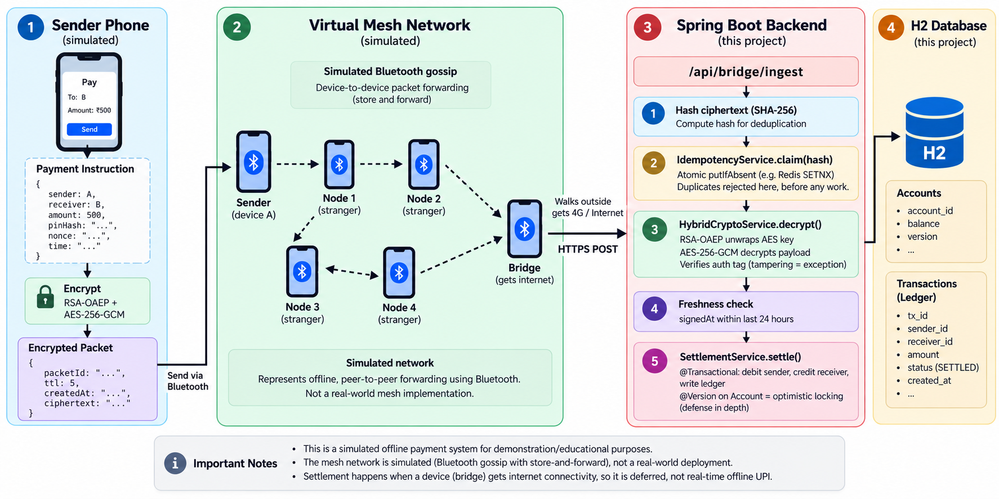
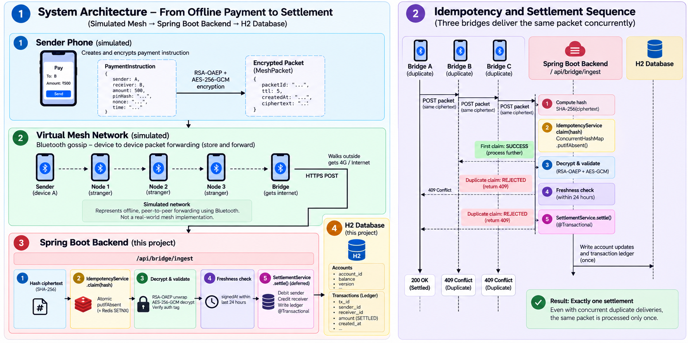

# MeshPay

MeshPay is a simulated offline payment-mesh demo. It shows **mesh-routed deferred settlement of UPI-style payments**: this process encrypts a payment, copies the ciphertext between virtual phones, and settles it only after a bridge device uploads it to the backend.

The sender phone and the mesh are software. There is no Bluetooth radio, no NPCI connection, and no production payment rail. The server in this repository is a Spring Boot app with an in-memory H2 database.

The dashboard form defaults to ₹500 from `alice@demo` to `bob@demo`. That amount is an input, not a separate payment network.

---

## Ownership

| | |
|---|---|
| Author | Suman, the author recorded on this repository's only commit (`sumandey7684@gmail.com`) |
| Repository | https://github.com/sumandey7684/MeshPay |
| Project role | Spring Boot backend and in-process mesh simulator for the demo above |
| Recorded date | 15 October 2026, the author date of the commit whose message is `first commit`. Git has no earlier history, so dates before that commit are not recorded |
| Stack | Java 17, Spring Boot 3.3.5 |
| Run | Windows: `mvnw.cmd spring-boot:run` (PowerShell: `.\mvnw.cmd spring-boot:run`). macOS/Linux: `./mvnw spring-boot:run` |

Java packages stay `com.demo.upimesh`. The Maven artifact id in `pom.xml` stays `upi-offline-mesh`.

The only commit adds this demo in its current form: backend, simulator, dashboard, and tests. The repository does not record a split of work across people, or a development timeline before that commit.

---

## Table of Contents

1. [What this demo proves](#what-this-demo-proves)
2. [How to run it](#how-to-run-it)
3. [The demo flow (step by step)](#the-demo-flow-step-by-step)
4. [Architecture](#architecture)
5. [The three hard problems and how they're solved](#the-three-hard-problems-and-how-theyre-solved)
6. [File-by-file walkthrough](#file-by-file-walkthrough)
7. [API reference](#api-reference)
8. [Tests](#tests)
9. [What's NOT real (and what would change for production)](#whats-not-real-and-what-would-change-for-production)
10. [Honest limitations of the concept](#honest-limitations-of-the-concept)

---

## What this demo proves

Three properties are implemented in this repository:

1. **The payment instruction is encrypted before it is copied through the simulator.** RSA-OAEP wraps a one-time AES-256 key. AES-256-GCM encrypts the JSON. Virtual devices can read `packetId`, `ttl`, and `createdAt`. They do not receive the server private key.
2. **The same ciphertext settles once inside this JVM.** `IdempotencyService` claims a SHA-256 of the ciphertext with `ConcurrentHashMap.putIfAbsent`. This is not a distributed lock and it is not Redis.
3. **A tampered ciphertext is rejected before settlement.** Flipping the ciphertext makes `HybridCryptoService.decrypt` throw. `BridgeIngestionService` then returns outcome `INVALID`.

**What the dashboard shows.** The default seed has five devices. Only `phone-bridge` is constructed with `hasInternet=true`. The dashboard shows encryption, one all-to-all gossip round, and a single in-process upload from that bridge.

**What the test shows.** Concurrent duplicate protection is `IdempotencyConcurrencyTest#singlePacketDeliveredByThreeBridgesSettlesExactlyOnce`. Three threads call `ingest` on one ₹100.00 packet. The test asserts one `SETTLED` outcome, two `DUPLICATE_DROPPED` outcomes, and a single ₹100.00 debit and credit between `alice@demo` and `bob@demo`. The default dashboard does not run that case.

---

## How to run it

### Prerequisites

- **JDK 17 or newer** on `PATH`, or `JAVA_HOME` set. Check with `java -version`.
- No separate database, Redis, or Maven install. The Maven wrapper downloads what it needs on the first run.

### Run on Windows

```cmd
mvnw.cmd spring-boot:run
```

On PowerShell, use `.\mvnw.cmd spring-boot:run`.

### Run on Mac/Linux

```bash
./mvnw spring-boot:run
```

### Open the dashboard

When the log shows `Started UpiMeshApplication`, open **http://localhost:8080**. The port is `server.port` in `application.properties`. The page follows the browser color scheme and has a light/dark toggle.

Startup seeds four accounts when the table is empty:

| VPA | Holder | Balance |
|---|---|---|
| `alice@demo` | Alice | ₹5000.00 |
| `bob@demo` | Bob | ₹1000.00 |
| `carol@demo` | Carol | ₹2500.00 |
| `dave@demo` | Dave | ₹500.00 |

`spring.jpa.hibernate.ddl-auto=create-drop`, so those rows disappear when the process stops. The sender dropdown lists Alice, Bob, and Carol. Dave is only in the receiver dropdown. The amount field defaults to 500.

### Stop the server

`Ctrl+C` in the terminal.

### Run the tests

```cmd
mvnw.cmd test
```

On PowerShell, use `.\mvnw.cmd test`. The class is `IdempotencyConcurrencyTest`.

---

## The demo flow (step by step)

The mesh controls walk through encryption, simulated gossip, and one bridge upload.

### Step 1 — Compose a payment

Choose sender, receiver, amount, and a 4-digit PIN. Click **Inject into Mesh**.

The dashboard `POST`s `/api/demo/send` with `ttl: 5` and `startDevice: "phone-alice"`. `DemoService.createPacket` then:

- builds a `PaymentInstruction` with a new UUID nonce and `signedAt` set to the current time
- stores `SHA-256` of the PIN string in `pinHash` and does not check it against an account
- encrypts that object with the server public key
- wraps the ciphertext in a `MeshPacket` and holds it on `phone-alice`

`phone-alice` then shows a queue of 1. The other devices are still empty.

### Step 2 — Run gossip rounds

Click **Run One Round**.

`MeshSimulatorService.gossipOnce` treats every device as in range of every other device. Each device that holds a packet with `ttl > 0` offers a copy to the others. A device that already holds that `packetId` keeps its existing copy. A new copy is stored with `ttl - 1`.

Starting from `phone-alice` at TTL 5, one round leaves the other four devices holding a copy at TTL 4. `phone-alice` still holds TTL 5. A second round does not transfer that packet again, and it does not lower the TTL already stored.

This is not Bluetooth. Nothing in the simulator waits for devices to move into range.

### Step 3 — Upload from the bridge

Click **Upload from Bridge**.

`phone-bridge` is created already online. The click does not change connectivity. `POST /api/mesh/flush` collects packets held by devices with `hasInternet=true` and calls `BridgeIngestionService.ingest` in this process, in parallel. It does not make an HTTP request to `/api/bridge/ingest`. With the default seed that is one call.

The hop count passed by flush is `5 - packet.ttl`. After one gossip round, the bridge copy has TTL 4, so the stored hop count is 1. That number is not a count of how many devices held the packet.

`ingest` then:

1. Hashes the base64 ciphertext string with SHA-256.
2. Calls `IdempotencyService.claim`. A false result returns outcome `DUPLICATE_DROPPED` and does not decrypt.
3. Decrypts. Failure returns outcome `INVALID` and reason `decryption_failed`. The hash stays claimed.
4. Rejects `signedAt` older than `upi.mesh.packet-max-age-seconds` (86400) as `stale_packet`, and `signedAt` more than 300 seconds in the future as `future_dated`. The hash stays claimed.
5. Calls `SettlementService.settle` in one database transaction.

If the sender balance covers the amount, the ledger row status is `SETTLED` and the balances move. If it does not, the ledger row status is `REJECTED`, balances stay put, and the JSON `outcome` is still `SETTLED`, because `ingest` labels every transaction returned by `settle` that way. An unknown VPA or a non-positive amount throws and becomes outcome `INVALID`.

The Account Balances and Transaction Ledger tables show the H2 rows. Ledger status is only `SETTLED` or `REJECTED`. `DUPLICATE_DROPPED` and `INVALID` are ingest outcomes, not ledger statuses. The dashboard filter also lists Pending, Duplicate, and Invalid; those values do not match rows this backend writes.

### Step 4 — Where concurrent idempotency is proved

Gossip can place one packet on all five devices. The default seed still has one bridge, so **Upload from Bridge** calls `ingest` once.

The concurrent case is the test:

```cmd
mvnw.cmd test -Dtest=IdempotencyConcurrencyTest#singlePacketDeliveredByThreeBridgesSettlesExactlyOnce
```

That test builds one ₹100.00 packet from `alice@demo` to `bob@demo`, starts three threads together, and calls `ingest` on each. It asserts exactly one `SETTLED`, two `DUPLICATE_DROPPED`, and a single ₹100.00 balance change. It does not assert an HTTP status.

`seedDefaultDevices()` is private. Editing it so more than one device is constructed with internet would make flush call `ingest` more than once. The default seed does not do that, and the test above is the checked concurrent path.

---

## Architecture

The running demo is one JVM. `DemoService` plays the sender phone. `MeshSimulatorService` plays the mesh. `BridgeIngestionService` is the backend pipeline. H2 stores accounts and the ledger. Settlement waits until `ingest` runs, so it is deferred, not a real-time payment.



The picture is a concept drawing. These details follow the code instead:

- The default seed is five devices: `phone-alice`, `phone-stranger1`, `phone-stranger2`, `phone-stranger3`, and `phone-bridge`. The drawing shows a sender, four relay nodes, and a bridge.
- The upload arrow is labeled HTTPS. This demo listens on HTTP port 8080. Dashboard flush does not use HTTP for ingest; it calls `BridgeIngestionService` directly. `POST /api/bridge/ingest` is the HTTP entry to the same method.
- The claim step is labeled with Redis `SETNX` as an example. The implementation is `ConcurrentHashMap.putIfAbsent` in this process.
- `phone-bridge` starts online. The demo does not animate a phone walking into coverage.

---

## The three hard problems and how they're solved

### Problem 1: Untrusted intermediates

A simulated relay holds the packet. The payment fields sit inside the ciphertext.

**Implemented scheme: RSA-OAEP plus AES-256-GCM.**

`HybridCryptoService` uses `RSA/ECB/OAEPWithSHA-256AndMGF1Padding` and `AES/GCM/NoPadding`. For each packet it:

1. Generates a new AES-256 key.
2. Encrypts the payment JSON with AES-256-GCM, using a 12-byte IV and a 128-bit tag.
3. Wraps that 32-byte AES key with RSA-OAEP and the server public key.
4. Concatenates `[256-byte RSA-wrapped AES key][12-byte IV][AES ciphertext including the 16-byte tag]` and Base64-encodes it.

RSA-2048 with OAEP-SHA-256 can encrypt at most 190 bytes (`256 - 2×32 - 2`). The AES key fits. The payment JSON is not encrypted directly with RSA.

AES-GCM checks the tag on decrypt. A changed ciphertext throws, and `ingest` returns `INVALID`. These are the primitives in `HybridCryptoService`. They are not the TLS protocol.

The RSA key pair is generated in `ServerKeyHolder` on startup and is discarded when the process exits. `GET /api/server-key` returns the public key as Base64, plus the strings `RSA-2048 / OAEP-SHA256` and a short hybrid-scheme label.

### Problem 2: The duplicate-storm

If several online devices hold the same ciphertext, each can call `ingest`. Processing every call would debit the sender once per call.

Three `ingest` calls for one ₹500 ciphertext would debit ₹1500 if the claim were skipped. That figure is an illustration. Clicking **Inject into Mesh** three times does not create that case: each click builds a new ciphertext. The test uses one ₹100.00 packet and three threads.

**Implemented claim:** hash the ciphertext, then `putIfAbsent`.

```java
// IdempotencyService.java
Instant prev = seen.putIfAbsent(packetHash, now);
return prev == null;  // true = first claimer, false = duplicate
```

One caller receives `null` and continues. Other callers for that hash receive the existing entry and get outcome `DUPLICATE_DROPPED` before decrypt. The map lives in this JVM. Entries older than `upi.mesh.idempotency-ttl-seconds` (86400) are removed by a job scheduled every 60 seconds. The test checks three threads, not a larger pool.



Read the right-hand sequence as the intended claim order, with these corrections from the code:

- Duplicate calls are not HTTP 409. `POST /api/bridge/ingest` returns HTTP 200 for `SETTLED`, `DUPLICATE_DROPPED`, and `INVALID`. The body field `outcome` distinguishes them. Flush does not go through HTTP.
- The Redis label is a production analogy. This process uses `ConcurrentHashMap` only.
- A failed decrypt or a failed freshness check does not remove the claim. A later copy of that same ciphertext is `DUPLICATE_DROPPED`, not a second `INVALID`.

**Why the hash is the ciphertext string, not `packetId` or the plaintext**

- `packetId` is an outer field. A relay can change it. Gossip dedupes on `packetId`; the server does not.
- Hashing the plaintext would require decrypting before the claim.
- Gossip copies the ciphertext bytes. It does not encrypt again. Two deliveries of that same packet therefore have the same hash. A second legitimate payment gets a new nonce, a new AES key, and a new IV, so it has a new hash.

`transactions.packet_hash` is unique. A second insert of the same hash fails. `ingest` catches that exception and returns `INVALID` with an `internal_error` reason. That path is not `DUPLICATE_DROPPED`. The normal duplicate path is the map. `TransactionRepository.existsByPacketHash` is unused.

`Account.version` is a JPA `@Version` column. The concurrency test does not assert an optimistic-lock failure.

A production deployment that runs more than one server would need a shared claim, such as Redis `SET key NX EX`. That client is not in this repository.

### Problem 3: Replay

`PaymentInstruction` carries `signedAt` (epoch millis) and a UUID `nonce`, both inside the ciphertext.

1. The first `ingest` of a ciphertext claims its hash. Further copies are `DUPLICATE_DROPPED` until that map entry is evicted.
2. `signedAt` older than 86400 seconds returns `INVALID` / `stale_packet` on the call that first claims the hash. `signedAt` more than 300 seconds ahead of the server clock returns `INVALID` / `future_dated`.
3. Two payments from Alice to Bob with the same amount differ in nonce, so they differ in ciphertext and can both settle. A byte-identical ciphertext cannot.

Changing `signedAt` or the nonce inside a captured packet breaks the GCM tag.

The PIN is not a replay control. The server stores a SHA-256 hex of the PIN string and never compares it to a stored secret.

---

## File-by-file walkthrough

The project folder is MeshPay. Packages below stay `com.demo.upimesh`.

```
MeshPay/
├── pom.xml                                  Maven build, Spring Boot 3.3.5, Java 17
├── mvnw, mvnw.cmd                           Maven wrapper
├── README.md                                this file
├── docs/
│   ├── system-architecture.png              Architecture figure used above
│   └── idempotency-flow.png                 Idempotency figure used above
└── src/main/
    ├── resources/
    │   ├── application.properties           H2, port 8080, 86400-second windows
    │   └── templates/dashboard.html         Demo UI
    └── java/com/demo/upimesh/
        ├── UpiMeshApplication.java          Spring Boot main class
        ├── model/
        │   ├── Account.java                 JPA entity, @Version column
        │   ├── AccountRepository.java       Spring Data JPA
        │   ├── Transaction.java             Ledger row, unique packetHash
        │   ├── TransactionRepository.java   findTop20ByOrderByIdDesc
        │   ├── MeshPacket.java              Outer fields plus ciphertext
        │   └── PaymentInstruction.java      Decrypted payload
        ├── crypto/
        │   ├── ServerKeyHolder.java         RSA-2048 key pair generated at startup
        │   └── HybridCryptoService.java     RSA-OAEP + AES-256-GCM, ciphertext hash
        ├── service/
        │   ├── DemoService.java             Seeds accounts, builds packets
        │   ├── VirtualDevice.java           One simulated phone
        │   ├── MeshSimulatorService.java    In-memory gossip
        │   ├── IdempotencyService.java      JVM-local ConcurrentHashMap claim
        │   ├── SettlementService.java       Transactional debit, credit, ledger insert
        │   └── BridgeIngestionService.java  hash → claim → decrypt → freshness → settle
        ├── controller/
        │   ├── ApiController.java           REST endpoints
        │   └── DashboardController.java     GET / serves the dashboard
        └── config/
            └── AppConfig.java               @EnableScheduling for claim eviction

src/test/java/com/demo/upimesh/
└── IdempotencyConcurrencyTest.java          Round trip, tamper, and 3-thread claim
```

---

## API reference

| Method | Path | What it does |
|---|---|---|
| GET | `/` | Dashboard HTML |
| GET | `/api/server-key` | Public key (Base64), algorithm label, hybrid-scheme label |
| GET | `/api/accounts` | All accounts |
| GET | `/api/transactions` | Latest 20 ledger rows, highest id first |
| GET | `/api/mesh/state` | Each virtual device, plus `idempotencyCacheSize` |
| POST | `/api/demo/send` | Encrypt a payment and hold it on a simulated device. Default device is `phone-alice`. Default TTL is 5 |
| POST | `/api/mesh/gossip` | One all-to-all gossip round. Returns transfer count and per-device queue sizes |
| POST | `/api/mesh/flush` | In-process `ingest` for every packet held by an online device, via `parallelStream` |
| POST | `/api/mesh/reset` | Clears held packets and the idempotency map. Does not delete accounts or ledger rows |
| POST | `/api/bridge/ingest` | HTTP entry to `ingest`. Returns HTTP 200 and an `IngestResult` |
| GET | `/h2-console` | H2 console, enabled in `application.properties` |

H2 console: JDBC URL `jdbc:h2:mem:upimesh`, username `sa`, empty password.

### `POST /api/bridge/ingest`

Headers `X-Bridge-Node-Id` (default `unknown`) and `X-Hop-Count` (default `0`) are stored on the ledger row when settlement runs.

```http
POST /api/bridge/ingest
Content-Type: application/json
X-Bridge-Node-Id: phone-bridge
X-Hop-Count: 1

{
  "packetId": "550e8400-e29b-41d4-a716-446655440000",
  "ttl": 4,
  "createdAt": 1730000000000,
  "ciphertext": "base64-encoded-RSA-wrapped-AES-key-and-GCM-payload"
}
```

HTTP 200 body:

```json
{
  "outcome": "SETTLED",
  "packetHash": "hex sha-256 of the ciphertext string",
  "reason": null,
  "transactionId": 1
}
```

`outcome` is `SETTLED`, `DUPLICATE_DROPPED`, or `INVALID`. `reason` is set for `INVALID` (`decryption_failed`, `stale_packet`, `future_dated`, or `internal_error: ...`). `transactionId` is set when `settle` returns a row, including a row whose ledger status is `REJECTED`. Duplicate and invalid results leave `transactionId` null. This endpoint is not authenticated.

`POST /api/mesh/flush` does not send this HTTP request. It calls the same service method with the device id and hop count `5 - ttl`.

---

## Tests

```cmd
mvnw.cmd test
```

`IdempotencyConcurrencyTest` has three tests:

- **`encryptDecryptRoundTrip`** — encrypts a `PaymentInstruction` and checks sender, receiver, amount, and nonce after decrypt.
- **`tamperedCiphertextIsRejected`** — flips one character of the ciphertext and expects outcome `INVALID`.
- **`singlePacketDeliveredByThreeBridgesSettlesExactlyOnce`** — three threads, one ₹100.00 packet, one `SETTLED`, two `DUPLICATE_DROPPED`, and one ₹100.00 balance change.

---

## What's NOT real (and what would change for production)

This table is a list of replacements. None of the right-hand column is implemented here.

| What's in the demo | What a production deployment would still need |
|---|---|
| H2 in memory, `create-drop` | A durable database |
| `ConcurrentHashMap` in one JVM | A shared claim across processes, such as Redis `SET key NX EX` |
| RSA key pair generated on startup | A private key outside the process, with the public key available to senders |
| `DemoService.createPacket()` on the server | Packet creation on the sender's device |
| `MeshSimulatorService` all-to-all copy | A real radio transport |
| This service owns the account balances | A ledger that can refuse an unfunded payment before the sender shows success |
| No authentication on `/api/bridge/ingest` | Authenticated bridge calls |
| Four accounts inserted at startup | Real account holders |
| H2 console enabled | Console disabled |
| No rate limiting | Limits on bridge and sender traffic |
| Console logs | Operational logging |

The demo does implement hybrid encryption and the in-process hash claim described above.

---

## Honest limitations of the concept

These limits follow from settling only after a later upload. They are not cured by the simulator.

1. **The receiver cannot verify funds from the packet.** The ciphertext does not prove the sender's balance. In this demo, an unfunded payment becomes a ledger row with status `REJECTED` and does not move money. The ingest JSON `outcome` for that row is still `SETTLED`.
2. **Two different offline payments can both be created.** Distinct nonces produce distinct ciphertext hashes. The first packet that settles debits the account. A later packet that no longer fits the balance is stored as `REJECTED`.
3. **The mesh is not a network.** One round copies a packet from every holder to every other device. The project does not implement Bluetooth, Wi-Fi Direct, or background delivery.
4. **Relays see metadata.** They can read `packetId`, `ttl`, `createdAt`, and the ciphertext blob. They cannot decrypt the payload with the keys this demo gives them.

Call the concept **mesh-routed deferred settlement**. It is not real-time offline UPI.

---

## Troubleshooting

**`java: command not found`** — Install JDK 17 or newer and open a new terminal.

**Port 8080 already in use** — Change `server.port` in `application.properties`.

**The first `mvnw.cmd` run takes a long time** — The wrapper is downloading Maven and the project dependencies.

**`mvnw.cmd` is not recognized in PowerShell** — Run `.\mvnw.cmd spring-boot:run` from the project directory.

**Balances reset after a restart** — H2 is in memory and `ddl-auto` is `create-drop`.

---

## License

This repository has no `LICENSE` file, and this README does not grant one. Reading and running the demo locally is what the project is published for. Copying, modification, and redistribution are not permitted until the owner adds an explicit license.
